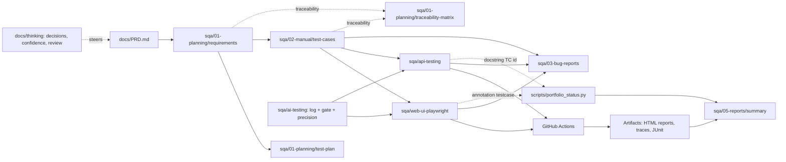

# Architecture — QA Portfolio

> SPECIFY phase. How the repository and test framework are organized.

## 1. Big picture



### Site layer
```
index.html ──► web3/index.html ──┐
          └──► sqa/index.html ───┼──► projects/nilo.html (shared case study)
assets/style.css (shared)        │
sqa/* (evidence) ◄───────────────┘ linked from the SQA page
```
The site is static HTML/CSS with no build step, so GitHub Pages can serve it directly. The QA tree under `sqa/` is evidence and is never required to render the site.

## 2. Technology choices
| Concern | Choice | Reason |
|---|---|---|
| UI automation | Playwright + TypeScript | Auto-wait, multi-browser, traces, strong typing |
| Design pattern | Page Object Model + custom fixtures | Maintainability, readable tests |
| API automation | pytest + requests + jsonschema | Simple, expressive, schema contract checks |
| Reporting | Playwright HTML/JSON, pytest-html + JUnit | Human + machine-readable |
| CI/CD | GitHub Actions | Native to GitHub, free for public repos |
| Repo checks | `scripts/portfolio_status.py` (stdlib only) | Traceability, placeholders, metrics without extra dependencies |
| Local fallback SUT | Static mock (Node) + stdlib Python mock | Offline runs and framework self-test |
| Docs | Markdown (Mermaid diagrams) | Zero tooling |
| Site | Static HTML + CSS (no framework) | Free hosting on GitHub Pages, nothing to maintain |

> Adding a dependency? Record why here.

## 3. Folder responsibilities
| Folder | Responsibility | Never contains |
|---|---|---|
| `docs/` | Cross-cutting docs and thinking logs (shared by both portfolios) | Test code |
| `web3/` | Web3 Builder page and claim checklist | Unverified on-chain claims |
| `projects/` | Case studies shared by both portfolios | Duplicated content |
| `sqa/` | The whole QA tree (planning to reports) | Site styling |
| `sqa/01-planning/` | What & why | Executable tests |
| `sqa/02-manual/` | Test case design + manual execution + non-functional checklist | Automation code |
| `sqa/03-bug-reports/` | Defects with evidence | Speculative bugs |
| `sqa/web-ui-playwright/` | UI automation (+ `mock-sut/`) | API tests |
| `sqa/api-testing/` | API automation (+ `tools/` mock) | UI tests |
| `sqa/ai-testing/` | AI-assisted testing rules, log, precision, prompts | Unverified AI output presented as evidence |
| `sqa/04-ci-cd/` | Pipeline documentation | Secrets |
| `sqa/05-reports/` | Summaries + generator script | Raw logs |
| `scripts/` | Repo-level checks | Test logic |
| `sqa/web3-testing/` | Optional smart-contract QA | Mainnet attacks |

## 4. UI framework layout (`sqa/web-ui-playwright/`)
```
pages/       Page objects: locators + user actions
fixtures/    Playwright fixtures injecting page objects and logged-in state
tests/       Specs grouped by feature; tagged @smoke / @regression
utils/       Test data and helpers
mock-sut/    Local fallback app (NOT the real SauceDemo) + tiny static server
playwright.config.ts        Real target (env-driven)
playwright.mock.config.ts   Same suite against the local mock
```

## 5. API framework layout (`sqa/api-testing/`)
```
utils/client.py    Thin HTTP client (timeouts, base URL)
utils/data.py      Payload builders
utils/schemas.py   JSON schemas for contract checks
conftest.py        Fixtures: client, auth token, disposable resources with cleanup
tests/             Specs by resource; markers: smoke, regression, negative, schema
tools/             mock_booker.py — local fallback API (encodes documented behavior only)
```

## 6. Configuration
| Variable | Used by | Default |
|---|---|---|
| `BASE_URL` | UI | `https://www.saucedemo.com` |
| `SAUCE_USER` / `SAUCE_PASSWORD` | UI | public demo credentials |
| `API_BASE_URL` | API | `https://restful-booker.herokuapp.com` |
| `API_USER` / `API_PASSWORD` | API | public demo credentials |

All overridable via `.env` locally and GitHub Actions variables/secrets in CI.

## 7. Traceability
`REQ-*` → `TC-*` (manual) → automated test (annotation/docstring with the TC id) → results in report. `scripts/portfolio_status.py` fails on references to unknown IDs and reports requirements without test cases.

## 8. CI/CD flow
Push / PR / nightly → install → run tests → upload artifacts → write summary to the job summary page. A separate lightweight workflow runs the repo checks. Details: [`sqa/04-ci-cd/README.md`](../sqa/04-ci-cd/README.md).

## 9. Security
See [SECURITY.md](../SECURITY.md). No secrets in the repo; synthetic data only.
